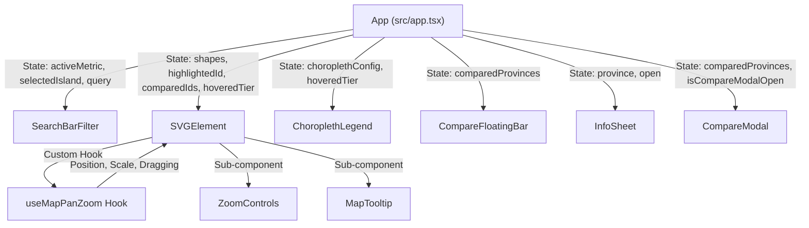

# Architecture & Technical Design Document (ARCHITECTURE.md)

## Indonesia Interactive Map (Geospatial Thematic System Architecture)

---

### Architecture Metadata

- **Application:** Indonesia Interactive Map
- **Version:** 1.0.0
- **Architectural Pattern:** Client-side Component-Driven Single Page Application (SPA)
- **Primary Language:** TypeScript 5.2 (Strict Mode)
- **UI Framework & Tooling:** React 18.3, Vite 5.3
- **Design System:** Tailwind CSS 3.4 (Neobrutalism Design Tokens)

---

## 1. System Overview

The **Indonesia Interactive Map** architecture adheres to a **zero-backend runtime dependency** paradigm. All spatial calculations, statistical quantile classifications, text search indexing, and vector coordinate transformations execute client-side in the user's browser.

```
┌────────────────────────────────────────────────────────────────────────┐
│                        CONCEPTUAL ARCHITECTURE                         │
└──────────────────────────────────┬─────────────────────────────────────┘
                                   │
       ┌───────────────────────────┴───────────────────────────┐
       ▼                                                       ▼
┌──────────────────────────────┐        ┌──────────────────────────────┐
│       PRESENTATION LAYER     │        │        DATA & DOMAIN         │
│   (React + Framer Motion)    │        │         COMPUTATION          │
├──────────────────────────────┤        ├──────────────────────────────┤
│ • App Orchestrator           │        │ • indonesia-map.json (38 Prov│
│ • SVGElement & Motion Paths  │◄───────┤ • computeChoropleth Engine   │
│ • SearchBarFilter Header     │        │ • getProvincePathStyle       │
│ • ChoroplethLegend Dock      │        │ • useMapPanZoom Clamping Math│
│ • CompareModal & FloatingBar │        │ • useTheme LocalStorage Sync │
│ • InfoSheet Drawer           │        │ • extractPathData.js Pipeline│
└──────────────────────────────┘        └──────────────────────────────┘
```

---

## 2. Directory & Module Structure

The repository enforces strict separation of concerns across presentation, business logic, and spatial assets:

```
indonesia-map/
├── public/                       # Static public assets
│   └── map/
│       └── indonesia.svg         # Source 38-province master SVG file
├── src/
│   ├── components/               # React UI components
│   │   ├── ui/                   # Atomic Radix UI primitives (dialog, sheet, toast)
│   │   │   ├── dialog.tsx
│   │   │   ├── sheet.tsx
│   │   │   ├── toast.tsx
│   │   │   └── toaster.tsx
│   │   ├── choropleth-legend.tsx # Thematic legend with interactive quantile hover
│   │   ├── compare-floating-bar.tsx # Bottom floating comparison action dock
│   │   ├── compare-modal.tsx     # Side-by-side comparative modal dialog
│   │   ├── info-sheet.tsx        # Right slide-over province detail drawer
│   │   ├── map-tooltip.tsx       # Floating Neobrutalist contextual tooltip
│   │   ├── search-bar-filter.tsx # Sticky header with search, metrics & island filter
│   │   ├── svg-element.tsx       # SVG vector map canvas with event orchestration
│   │   ├── theme-toggle.tsx      # Dark / light theme switcher button
│   │   └── zoom-controls.tsx     # Canvas zoom dock (+, -, reset)
│   ├── data/
│   │   └── indonesia-map.json    # Master dataset: 38 provinces, SVG paths, statistics
│   ├── hooks/                    # Custom React hooks
│   │   ├── use-map-pan-zoom.ts   # Gesture, wheel, drag, and boundary clamping engine
│   │   ├── use-theme.ts          # DOM class synchronization & localStorage persistence
│   │   └── use-toast.ts          # Mini-reducer based notification manager
│   ├── interfaces/               # Strict TypeScript type contracts
│   │   ├── choropleth.ts         # Metrics, tiers, and choropleth configuration types
│   │   └── province.ts           # Province entity schema
│   ├── lib/
│   │   └── utils.ts              # Class name merging utility (clsx + tailwind-merge)
│   ├── utils/
│   │   ├── choropleth.ts         # Statistical quantile engine & number formatting
│   │   └── map-styles.ts         # Deterministic SVG path fill/stroke calculation
│   ├── app.tsx                   # Main root orchestrator & state manager
│   ├── index.css                 # CSS variables, brutalist grids, typography rules
│   └── main.tsx                  # React DOM entry point
├── utils/
│   └── extractPathData.js        # Node.js SVG path extraction CLI utility
├── package.json                  # Dependencies and build scripts
├── tailwind.config.js            # Neobrutalism design system tokens
└── vite.config.ts                # Bundler configuration with manual chunking
```

---

## 3. Component Architecture & Data Flow

The root `App` component acts as the **Single Source of Truth** for the application's global state, delegating computed properties to presentational components.



### 3.1 Data Flow Lifecycle

1. **Synchronous Bootstrapping:** `indonesia-map.json` is imported synchronously at load time.
2. **Reactive Choropleth Computation:** When `activeMetric` changes (`'none' | 'population' | 'density' | 'area'`), `useMemo` triggers `computeChoropleth`.
3. **Deterministic Styling:** Each `<path>` element's styles are derived via `getProvincePathStyle`, taking into account `isMatchIsland`, `isHighlighted`, `isCompared`, `isHovered`, and `hoveredTier`.
4. **Isolated Tooltip Updates:** Mousemove events update tooltip position locally without invalidating the statistical calculation cache.

---

## 4. Spatial & Statistical Computation Engine

### 4.1 5-Quantile Classification Algorithm

To prevent visual skew from extreme regional disparities (e.g., West Java with 49M residents vs. Southwest Papua with 600K), the system employs **equal-frequency quantile classification**:

Given an ascending sorted dataset $V = \{v_1, v_2, \dots, v_{38}\}$ where $v_i \le v_{i+1}$:

$$\text{Cutoff Point } Q_k = V\left[\lfloor n \cdot 0.2k \rfloor\right] \quad \text{for } k \in \{1, 2, 3, 4\}$$

The tiers are assigned as follows:

- **Tier 1:** $v \le Q_1$ (Lowest 20%)
- **Tier 2:** $Q_1 < v \le Q_2$ (20% – 40%)
- **Tier 3:** $Q_2 < v \le Q_3$ (40% – 60%)
- **Tier 4:** $Q_3 < v \le Q_4$ (60% – 80%)
- **Tier 5:** $v > Q_4$ (Top 20%)

### 4.2 Population Density Ratio

Computed dynamically at runtime:

$$\text{Density} = \left\lfloor \frac{\text{population}}{\text{areaKm2}} \right\rceil \quad (\text{people/km}^2)$$

### 4.3 SVG Path Styling Decision Matrix (`getProvincePathStyle`)

The `getProvincePathStyle` utility executes a deterministic decision tree for rendering each province path:

| Condition State                            | Fill Style                           | Stroke Style                                    | Stroke Width       | Opacity                        |
| ------------------------------------------ | ------------------------------------ | ----------------------------------------------- | ------------------ | ------------------------------ |
| **Compared Province (`isCompared`)**       | Quantile Color / Default Red         | Compare Color (`#2563eb`, `#f59e0b`, `#10b981`) | `3px`              | `1.0`                          |
| **Highlighted Province (`isHighlighted`)** | Quantile Color / Dark Red            | `#000000` (Light) / `#ffffff` (Dark)            | `2.5px`            | `1.0`                          |
| **Non-matching Island (`!isMatchIsland`)** | Neutral Gray (`#d4d4d8` / `#27272a`) | Subdued Stroke (`#a1a1aa` / `#3f3f46`)          | `0.5px`            | `0.25` (Dimmed)                |
| **Hovered (`isHovered`)**                  | Vivid Yellow (`#fef08a`) / White     | Metric Accent / Solid Black                     | `2.0px`            | `1.0`                          |
| **Legend Tier Filter (`hoveredTier`)**     | Quantile Tier Color                  | White / Black when matched                      | `1.5px` if matched | `1.0` (Match) / `0.25` (Other) |
| **Default State**                          | Quantile Color / Red `#ef4444`       | `#000000` / `#ffffff`                           | `0.75px`           | `1.0`                          |

---

## 5. Canvas Navigation Mathematics (Pan & Zoom Math)

In `src/hooks/use-map-pan-zoom.ts`, dynamic pan boundaries are calculated relative to current scale ($S$) and container dimensions ($W, H$):

$$\text{limitX}(S) = \frac{W \cdot S - W}{2} + 0.15 \cdot W$$

$$\text{limitY}(S) = \frac{H \cdot S - H}{2} + 0.15 \cdot H$$

When drag coordinates exceed these thresholds, elastic damping resistance is applied:

$$X_{\text{drag}} = X_{\text{bound}} + 0.25 \cdot (X_{\text{raw}} - X_{\text{bound}})$$

This provides natural, tactile feedback preventing the map from being lost outside the viewport.

---

## 6. Neobrutalism Design System & Tokens

UI styling is powered by custom Tailwind CSS design tokens defined in `tailwind.config.js`:

```javascript
// Hard offset shadows without blur
boxShadow: {
  'brutal': '4px 4px 0px 0px #000000',
  'brutal-sm': '2px 2px 0px 0px #000000',
  'brutal-lg': '6px 6px 0px 0px #000000',
  'brutal-xl': '8px 8px 0px 0px #000000',
  'brutal-white': '4px 4px 0px 0px #ffffff',
  'brutal-white-lg': '6px 6px 0px 0px #ffffff',
}
```

- **Thematic Sequential Palettes:**
  - _Population:_ 5-tier indigo/blue (`#dbeafe` to `#1e3a8a`).
  - _Density:_ 5-tier warm amber/orange/red (`#ffedd5` to `#9a3412`).
  - _Land Area:_ 5-tier emerald/teal (`#d1fae5` to `#064e3b`).
- **Architectural Canvas Grid:** `32px x 32px` brutalist grid background reinforcing technical cartography aesthetics.

---

## 7. Bundling Strategy & Performance Metrics

In `vite.config.ts`, Rollup manual chunking isolates heavy third-party libraries:

```typescript
rollupOptions: {
  output: {
    manualChunks: {
      'vendor-react': ['react', 'react-dom'],
      'vendor-motion': ['framer-motion'],
      'vendor-radix': ['@radix-ui/react-dialog', '@radix-ui/react-toast'],
      'vendor-icons': ['lucide-react'],
    },
  },
}
```

### Production Build Metrics

- `index.html`: $1.13\text{ kB}$ (gzip: $0.52\text{ kB}$)
- `index.css`: $36.05\text{ kB}$ (gzip: $6.75\text{ kB}$)
- `vendor-icons.js`: $12.11\text{ kB}$ (gzip: $2.73\text{ kB}$)
- `vendor-radix.js`: $43.32\text{ kB}$ (gzip: $14.43\text{ kB}$)
- `vendor-motion.js`: $114.20\text{ kB}$ (gzip: $37.70\text{ kB}$)
- `vendor-react.js`: $141.28\text{ kB}$ (gzip: $45.42\text{ kB}$)
- `index.js` (App Logic + 38 Province Polygons): $228.25\text{ kB}$ (gzip: $75.70\text{ kB}$)
- **Total Compressed Payload:** $\approx 183\text{ kB}$ (exceptionally lightweight for a fully-featured interactive thematic GIS map).

---

## 8. Spatial Data Pipeline (`extractPathData.js`)

The `utils/extractPathData.js` Node.js script provides non-destructive vector geometry synchronization:

1. Parses source vector elements from `public/map/indonesia.svg`.
2. Extracts `<path>` tags using flexible regular expressions that accommodate arbitrary attribute ordering (`id`, `name`, `d`).
3. Performs a non-destructive merge against `src/data/indonesia-map.json` by matching province IDs, preserving demographic and administrative metadata while updating coordinate geometries.
