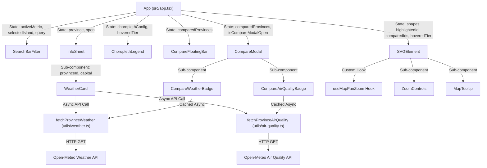

# Architecture & Technical Design Document (ARCHITECTURE.md)

## Indonesia Interactive Map (Geospatial Thematic & Environmental Architecture)

---

### Architecture Metadata

- **Application:** Indonesia Interactive Map
- **Version:** 1.1.0
- **Architectural Pattern:** Client-side Component-Driven Single Page Application (SPA) with Asynchronous Environmental Services
- **Primary Language:** TypeScript 5.2 (Strict Mode)
- **UI Framework & Tooling:** React 18.3, Vite 5.3
- **Design System:** Tailwind CSS 3.4 (Neobrutalism Design Tokens)
- **External Data Providers:** Open-Meteo Weather & Air Quality APIs (CC BY 4.0)

---

## 1. System Overview

The **Indonesia Interactive Map** architecture couples a high-performance, client-side geospatial rendering engine with an asynchronous, resilient **Atmospheric & Environmental Data Layer**.

All spatial polygon calculations, statistical quantile classifications, text search indexing, and vector coordinate transformations execute client-side in the user's browser without backend server dependencies. Real-time meteorological data (temperature, wind, humidity, weather conditions) and environmental data (Air Quality Index, PM2.5, PM10, Ozone) are fetched directly from open-source Open-Meteo APIs and managed via in-memory TTL caching.

```
┌────────────────────────────────────────────────────────────────────────┐
│                        CONCEPTUAL ARCHITECTURE                         │
└──────────────────────────────────┬─────────────────────────────────────┘
                                   │
       ┌───────────────────────────┼───────────────────────────┐
       ▼                           ▼                           ▼
┌─────────────────────────┐ ┌─────────────────────────┐ ┌─────────────────────────┐
│   PRESENTATION LAYER    │ │   DATA & COMPUTATION    │ │  ATMOSPHERIC & WEATHER  │
│ (React + Framer Motion) │ │   (Spatial & Stats)     │ │   (Open-Meteo Services) │
├─────────────────────────┤ ├─────────────────────────┤ ├─────────────────────────┤
│ • App Orchestrator      │ │ • indonesia-map.json    │ │ • fetchProvinceWeather  │
│ • SVGElement & Paths    │ │ • computeChoropleth     │ │ • fetchProvinceAirQuality│
│ • SearchBarFilter Header│ │ • getProvincePathStyle  │ │ • PROVINCE_COORDINATES  │
│ • ChoroplethLegend Dock │ │ • useMapPanZoom Math    │ │ • 10-Min In-Memory Cache│
│ • WeatherCard Widget    │ │ • useTheme LocalStorage │ │ • AbortController Timers│
│ • InfoSheet Drawer      │ │ • extractPathData.js    │ │ • WMO & AQI Interpreters│
│ • CompareModal Dialog   │ │                         │ │ • Timezone Normalizer   │
└─────────────────────────┘ └─────────────────────────┘ └─────────────────────────┘
```

---

## 2. Directory & Module Structure

The repository maintains strict separation of concerns across presentation, domain calculation, spatial datasets, and external asynchronous integrations:

```
indonesia-map/
├── public/                       # Static public assets
│   └── map/
│       └── indonesia.svg         # Source 38-province master SVG file
├── src/
│   ├── components/               # React UI components
│   │   ├── ui/                   # Atomic Radix UI primitives (dialog, sheet, toast)
│   │   │   ├── dialog.tsx
│   │   │   ├── sheet.tsx
│   │   │   ├── toast.tsx
│   │   │   └── toaster.tsx
│   │   ├── choropleth-legend.tsx # Thematic legend with interactive quantile hover
│   │   ├── compare-floating-bar.tsx # Bottom floating comparison action dock
│   │   ├── compare-modal.tsx     # Side-by-side comparative modal dialog with live badges
│   │   ├── info-sheet.tsx        # Right slide-over province detail drawer
│   │   ├── map-tooltip.tsx       # Floating Neobrutalist contextual tooltip
│   │   ├── search-bar-filter.tsx # Sticky header with search, metrics & island filter
│   │   ├── svg-element.tsx       # SVG vector map canvas with event orchestration
│   │   ├── theme-toggle.tsx      # Dark / light theme switcher button
│   │   ├── weather-card.tsx      # Dual-tab live Weather and Air Quality (AQI) card
│   │   └── zoom-controls.tsx     # Canvas zoom dock (+, -, reset)
│   ├── data/
│   │   └── indonesia-map.json    # Master dataset: 38 provinces, SVG paths, statistics
│   ├── hooks/                    # Custom React hooks
│   │   ├── use-map-pan-zoom.ts   # Gesture, wheel, drag, and boundary clamping engine
│   │   ├── use-theme.ts          # DOM class synchronization & localStorage persistence
│   │   └── use-toast.ts          # Mini-reducer based notification manager
│   ├── interfaces/               # Strict TypeScript type contracts
│   │   ├── air-quality.ts        # AQI category, pollutant thresholds, and payload types
│   │   ├── choropleth.ts         # Metrics, tiers, and choropleth configuration types
│   │   ├── province.ts           # Province entity schema
│   │   └── weather.ts            # Weather data, icons, and coordinates types
│   ├── lib/
│   │   └── utils.ts              # Class name merging utility (clsx + tailwind-merge)
│   ├── utils/
│   │   ├── air-quality.ts        # AQI evaluation, pollutant processing & cache
│   │   ├── choropleth.ts         # Statistical quantile engine & number formatting
│   │   ├── map-styles.ts         # Deterministic SVG path fill/stroke calculation
│   │   └── weather.ts            # Weather fetching, WMO decoding, timezones & cache
│   ├── app.tsx                   # Main root orchestrator & state manager
│   ├── index.css                 # CSS variables, brutalist grids, typography rules
│   └── main.tsx                  # React DOM entry point
├── utils/
│   └── extractPathData.js        # Node.js SVG path extraction CLI utility
├── package.json                  # Dependencies and build scripts
├── tailwind.config.js            # Neobrutalism design system tokens
└── vite.config.ts                # Bundler configuration with manual chunking
```

---

## 3. Component Architecture & Data Flow



---

## 4. Atmospheric & Environmental Intelligence Engine

### 4.1 Geodetic Coordinate Mapping

To query Open-Meteo APIs accurately for all 38 provinces, `src/utils/weather.ts` maintains exact geodetic coordinates for each provincial capital:

```typescript
export const PROVINCE_COORDINATES: Record<string, WeatherCoordinates> = {
  IDAC: { lat: 5.5483, lng: 95.3238, capital: 'Banda Aceh' },
  IDBA: { lat: -8.6705, lng: 115.2126, capital: 'Denpasar' },
  IDJK: { lat: -6.2088, lng: 106.8456, capital: 'Jakarta' },
  // ... All 38 provinces including the 4 Papua DOBs:
  IDPD: { lat: -0.8762, lng: 131.2558, capital: 'Sorong' }, // Papua Barat Daya
  IDPE: { lat: -4.0981, lng: 138.9442, capital: 'Wamena' }, // Papua Pegunungan
  IDPS: { lat: -8.4991, lng: 140.4011, capital: 'Merauke' }, // Papua Selatan
  IDPT: { lat: -3.3667, lng: 135.4833, capital: 'Nabire' }, // Papua Tengah
};
```

### 4.2 WMO Weather Interpretation Mapping

The system maps World Meteorological Organization (WMO) weather code integers to localized descriptions and semantic Lucide SVG icons:

| WMO Codes            | Localized Description                          | Lucide Icon                        |
| -------------------- | ---------------------------------------------- | ---------------------------------- |
| `0`                  | Cerah (Clear Sky)                              | `Sun` (with amber pulse animation) |
| `1, 2`               | Cerah Berawan / Sebagian Cerah (Partly Cloudy) | `CloudSun`                         |
| `3`                  | Berawan Tebal (Overcast)                       | `Cloud`                            |
| `45, 48`             | Berkabut (Fog / Depositing Rime Fog)           | `CloudFog`                         |
| `51, 53, 55, 80`     | Gerimis / Rintik Lokal (Drizzle)               | `CloudDrizzle`                     |
| `61, 63, 65, 81, 82` | Hujan Ringan, Sedang, Lebat (Rain)             | `CloudRain`                        |
| `95, 96, 99`         | Hujan Badai Petir (Thunderstorm)               | `CloudLightning`                   |

### 4.3 Air Quality Index (AQI) Evaluation Matrix

The US Air Quality Index (US AQI) is calculated and categorized into 6 standardized health impact tiers (`evaluateAQI` in `src/utils/air-quality.ts`):

| US AQI Range | Health Level                               | Badge Styling               | Actionable Advisory                                                                       |
| ------------ | ------------------------------------------ | --------------------------- | ----------------------------------------------------------------------------------------- |
| $\le 50$     | **Baik** (Good)                            | `bg-emerald-400 text-black` | Air quality is satisfactory; outdoor activities are fully safe.                           |
| $51 - 100$   | **Sedang** (Moderate)                      | `bg-amber-300 text-black`   | Air quality is acceptable; unusually sensitive individuals should observe caution.        |
| $101 - 150$  | **Kurang Sehat** (Unhealthy for Sensitive) | `bg-orange-400 text-black`  | Sensitive groups (children, elderly, respiratory patients) should limit outdoor exertion. |
| $151 - 200$  | **Tidak Sehat** (Unhealthy)                | `bg-red-500 text-white`     | General public may experience adverse health effects; masks recommended outdoors.         |
| $201 - 300$  | **Sangat Tidak Sehat** (Very Unhealthy)    | `bg-purple-600 text-white`  | Health alert; avoid strenuous physical activity outdoors.                                 |
| $> 300$      | **Berbahaya** (Hazardous)                  | `bg-rose-950 text-white`    | Emergency conditions; entire population should remain indoors.                            |

Additionally, specific pollutant concentrations are provided: $\text{PM}_{2.5}$ ($\mu\text{g/m}^3$), $\text{PM}_{10}$ ($\mu\text{g/m}^3$), and Ground-level Ozone $\text{O}_3$ ($\mu\text{g/m}^3$).

### 4.4 In-Memory Caching & Network Resilience

To prevent redundant API calls, mitigate network latency, and avoid rate limits:

1. **Time-to-Live (TTL) Cache:** Both weather and air quality responses are stored in module-scoped `Map` instances (`weatherCache`, `aqiCache`) with a 10-minute validity window (`CACHE_TTL_MS = 600,000`).
2. **Defensive Request Timeout:** Network requests initialize an `AbortController` configured with an 8,000 ms timeout to prevent hung connection states on slow networks.
3. **Graceful UI Fallbacks:** Network errors render informative retry notices without disrupting the map or detail sheet lifecycle.

### 4.5 Indonesian Timezone Normalization

Open-Meteo UTC offsets are parsed by `getIndonesianTimezoneLabel` to produce official national time zone acronyms:

- $+07:00$ ($25,200\text{ s}$ offset) $\rightarrow$ **WIB** (Waktu Indonesia Barat)
- $+08:00$ ($28,800\text{ s}$ offset) $\rightarrow$ **WITA** (Waktu Indonesia Tengah)
- $+09:00$ ($32,400\text{ s}$ offset) $\rightarrow$ **WIT** (Waktu Indonesia Timur)

Timestamps are formatted into clean localized Indonesian date strings (`formatDataTime`, `formatFetchTime`).

---

## 5. Spatial & Statistical Computation Engine

### 5.1 5-Quantile Classification Algorithm

Given an ascending sorted dataset $V = \{v_1, v_2, \dots, v_{38}\}$ where $v_i \le v_{i+1}$:

$$\text{Cutoff Point } Q_k = V\left[\lfloor n \cdot 0.2k \rfloor\right] \quad \text{for } k \in \{1, 2, 3, 4\}$$

- **Tier 1:** $v \le Q_1$ (Lowest 20%)
- **Tier 2:** $Q_1 < v \le Q_2$
- **Tier 3:** $Q_2 < v \le Q_3$
- **Tier 4:** $Q_3 < v \le Q_4$
- **Tier 5:** $v > Q_4$ (Top 20%)

### 5.2 Population Density Ratio

$$\text{Density} = \left\lfloor \frac{\text{population}}{\text{areaKm2}} \right\rceil \quad (\text{people/km}^2)$$

### 5.3 Deterministic SVG Path Styling Matrix (`getProvincePathStyle`)

| Condition State                            | Fill Style                           | Stroke Style                                    | Stroke Width       | Opacity                        |
| ------------------------------------------ | ------------------------------------ | ----------------------------------------------- | ------------------ | ------------------------------ |
| **Compared Province (`isCompared`)**       | Quantile Color / Red                 | Compare Color (`#2563eb`, `#f59e0b`, `#10b981`) | `3px`              | `1.0`                          |
| **Highlighted Province (`isHighlighted`)** | Quantile Color / Dark Red            | `#000000` (Light) / `#ffffff` (Dark)            | `2.5px`            | `1.0`                          |
| **Non-matching Island (`!isMatchIsland`)** | Neutral Gray (`#d4d4d8` / `#27272a`) | Subdued Stroke (`#a1a1aa` / `#3f3f46`)          | `0.5px`            | `0.25` (Dimmed)                |
| **Hovered (`isHovered`)**                  | Vivid Yellow (`#fef08a`) / White     | Metric Accent / Solid Black                     | `2.0px`            | `1.0`                          |
| **Legend Tier Filter (`hoveredTier`)**     | Quantile Tier Color                  | White / Black when matched                      | `1.5px` if matched | `1.0` (Match) / `0.25` (Other) |
| **Default State**                          | Quantile Color / Red `#ef4444`       | `#000000` / `#ffffff`                           | `0.75px`           | `1.0`                          |

---

## 6. Canvas Navigation Mathematics (Pan & Zoom Math)

In `src/hooks/use-map-pan-zoom.ts`, pan bounds are calculated relative to current scale ($S$) and container dimensions ($W, H$):

$$\text{limitX}(S) = \frac{W \cdot S - W}{2} + 0.15 \cdot W$$

$$\text{limitY}(S) = \frac{H \cdot S - H}{2} + 0.15 \cdot H$$

When drag coordinates exceed these thresholds, elastic damping resistance is applied:

$$X_{\text{drag}} = X_{\text{bound}} + 0.25 \cdot (X_{\text{raw}} - X_{\text{bound}})$$

---

## 7. Neobrutalism Design System & Standardized Iconography

- **Hard-Offset Shadow Tokens:**
  - `shadow-brutal`: `4px 4px 0px 0px #000000`
  - `shadow-brutal-sm`: `2px 2px 0px 0px #000000`
  - `shadow-brutal-lg`: `6px 6px 0px 0px #000000`
  - `shadow-brutal-xl`: `8px 8px 0px 0px #000000`
- **Iconography Standardization:** Replaced inline text glyphs with Lucide SVG icons (`Star`, `Check`, `Plus`, `ArrowRight`, `MapPin`, `Users`, `Maximize2`, `Clock`, `CloudSun`, `Wind`, `Activity`).
- **Continuous Marquee Ribbon:** Hardware-accelerated CSS marquee animation featuring standardized Star icons and national motto badges.

---

## 8. Bundling Strategy & Performance Metrics

Rollup vendor chunking isolates third-party dependencies:

```typescript
rollupOptions: {
  output: {
    manualChunks: {
      'vendor-react': ['react', 'react-dom'],
      'vendor-motion': ['framer-motion'],
      'vendor-radix': ['@radix-ui/react-dialog', '@radix-ui/react-toast'],
      'vendor-icons': ['lucide-react'],
    },
  },
}
```

### Production Build Footprint

- `index.html`: $1.13\text{ kB}$ (gzip: $0.52\text{ kB}$)
- `index.css`: $36.05\text{ kB}$ (gzip: $6.75\text{ kB}$)
- `vendor-icons.js`: $12.11\text{ kB}$ (gzip: $2.73\text{ kB}$)
- `vendor-radix.js`: $43.32\text{ kB}$ (gzip: $14.43\text{ kB}$)
- `vendor-motion.js`: $114.20\text{ kB}$ (gzip: $37.70\text{ kB}$)
- `vendor-react.js`: $141.28\text{ kB}$ (gzip: $45.42\text{ kB}$)
- `index.js` (App + 38 Polygons + Weather/AQI Engines): $228.25\text{ kB}$ (gzip: $75.70\text{ kB}$)
- **Total Compressed Payload:** $\approx 183\text{ kB}$ gzip.

---

## 9. Spatial Data Pipeline (`extractPathData.js`)

The `utils/extractPathData.js` Node.js script provides non-destructive vector geometry synchronization:

1. Parses source vector elements from `public/map/indonesia.svg`.
2. Extracts `<path>` tags using flexible regular expressions that accommodate arbitrary attribute ordering (`id`, `name`, `d`).
3. Performs a non-destructive merge against `src/data/indonesia-map.json` by matching province IDs, preserving demographic and administrative metadata while updating coordinate geometries.
