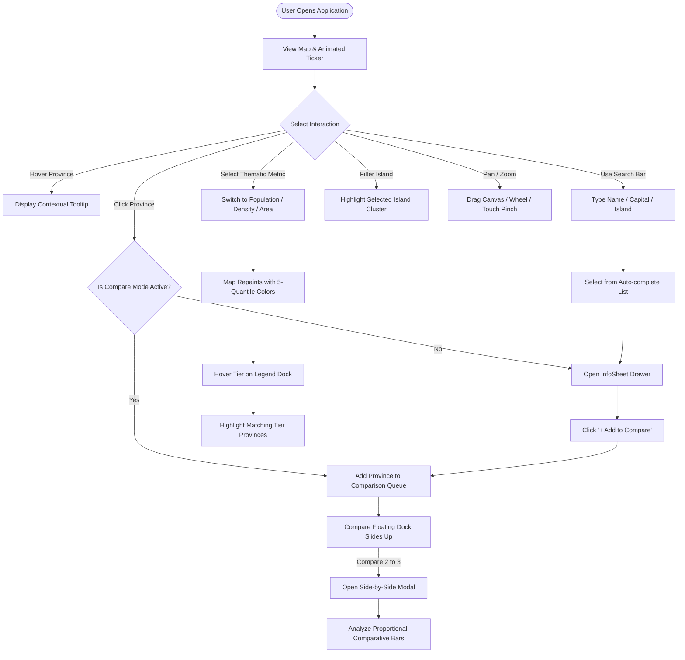

# Product Requirements Document (PRD)

## Indonesia Interactive Map (Digital Geospatial System for 38 Indonesian Provinces)

---

### Document Metadata

- **Project Name:** Indonesia Interactive Map
- **Document Version:** 1.0.0
- **Status:** Approved / Baseline Specification
- **Last Updated:** October 16, 2026
- **Target Platform:** Web (Desktop, Tablet, Mobile)
- **Core Technology Stack:** React 18, TypeScript, Vite, Tailwind CSS, Framer Motion, Radix UI

---

## 1. Executive Summary

**Indonesia Interactive Map** is a modern, interactive geospatial web application that showcases the archipelago of the Republic of Indonesia across all **38 official provinces**, fully incorporating the 4 New Autonomous Regions (DOB / _Daerah Otonom Baru_) in Papua (South Papua, Central Papua, Highland Papua, and Southwest Papua) in accordance with the latest government regulations.

The application pairs a bold, high-contrast **Neobrutalism** visual identity with lightweight analytical Geographic Information System (GIS) capabilities: thematic mapping (_Choropleth_ maps powered by official BPS statistical quantile distributions), island archipelago filters, instant keyboard-navigable search with auto-complete, fluid canvas navigation (_pan & pinch-to-zoom_), a side-by-side multi-province comparison matrix, and adaptive dark mode support.

---

## 2. Background & Problem Statement

### 2.1 Geopolitical Context & Territorial Expansion

Prior to 2022, Indonesia comprised 34 provinces. Following the ratification of parliamentary laws establishing four new provinces in Papua and the issuance of Ministry of Home Affairs Decree (_Kepmen Mendagri_) No. 100.1.1-6117 of 2022, the official number of provinces increased to 38. However, most digital cartographic assets and educational materials accessible online still depict the outdated 34-province administrative boundaries.

### 2.2 Problems Solved

1. **Outdated Digital Cartography:** Scarcity of modern, lightweight, interactive vector SVG maps representing all 38 provinces for students, educators, and developers.
2. **Static Demographic Data:** Official statistics from Statistics Indonesia (_Badan Pusat Statistik / BPS_) are predominantly distributed in static PDF tables or spreadsheets, making spatial pattern comprehension difficult for the general public and decision-makers.
3. **Absence of Direct Spatial Comparison:** Lack of tools that enable side-by-side comparison of sub-national indicators (population, land area, population density) without manual cross-referencing across separate reports.

---

## 3. Product Vision & Target Audience

### 3.1 Vision Statement

> _"To deliver the most precise, aesthetic, performant, and frictionless digital geospatial visualization portal for Indonesia, accessible from any device without requiring installation."_

### 3.2 Target Audience & User Personas

| Persona                         | Profile & Needs                                                                                                         | Usage Pattern                                                                                                           |
| ------------------------------- | ----------------------------------------------------------------------------------------------------------------------- | ----------------------------------------------------------------------------------------------------------------------- |
| **Educators & Students**        | Geography teachers, university lecturers, secondary school and college students needing up-to-date geography materials. | Exploring province locations, provincial capitals, official time zones (WIB/WITA/WIT), and regional island clusters.    |
| **Researchers & Data Analysts** | Public policy analysts, data journalists, and socio-economic researchers.                                               | Analyzing population disparities and comparing demographic densities across Java vs. outer islands using thematic maps. |
| **Web Developers & Designers**  | Frontend engineers and UI/UX designers seeking high-performance SVG vector map implementations.                         | Inspecting pan-zoom math, SVG path coordinate extraction pipelines, and Neobrutalist design systems.                    |
| **General Public**              | Citizens and enthusiasts wanting an intuitive, engaging tool to learn about Indonesia's geographic diversity.           | Looking up hometown data, checking national rankings, and sharing regional insights.                                    |

---

## 4. Functional Requirements

```
┌────────────────────────────────────────────────────────────────────────┐
│                        CORE APPLICATION FEATURES                       │
├─────────────────┬──────────────────┬─────────────────┬─────────────────┤
│ Interactive SVG │ Thematic Engine  │ Exploration &   │ Multi-Province  │
│ Vector Canvas   │ (Choropleth)     │ Search          │ Comparison      │
│                 │                  │                 │                 │
│ • 38 Provinces  │ • Population     │ • Auto-complete │ • Up to 3 provs │
│ • Pan & Zoom    │ • Density        │ • Island Filter │ • Floating Dock │
│ • Tooltip Hover │ • Land Area      │ • Detail Sheet  │ • Side-by-side  │
│ • Touch & Pinch │ • 5 Quantiles    │ • Dark/Light    │ • Visual Bars   │
└─────────────────┴──────────────────┴─────────────────┴─────────────────┘
```

### FR-01: Interactive Vector SVG Canvas

- **Specification:** Renders crisp, scalable vector graphics (SVG) representing all 38 Indonesian provinces inside a responsive `viewBox="0 0 800 350"`.
- **Interactions:**
  - _Hover State:_ Highlights the targeted province with a distinctive fill color and border stroke, triggering the contextual floating tooltip.
  - _Click State:_ Opens the province detail drawer (_InfoSheet_), or toggles selection if Comparison Mode is active.
  - _Focus State:_ Supports keyboard tab navigation (`Tab`, `Enter`, `Space`) with visible high-contrast focus rings.

### FR-02: Smooth Pan & Zoom Engine

- **Scale Range:** Minimum scale $0.75\times$ (75%), default scale $1.0\times$ (100%), up to a maximum of $6.0\times$ (600%).
- **Navigation Modalities:**
  1. _Mouse Drag:_ Fluid canvas panning with elastic resistance boundary damping when approaching viewport limits.
  2. _Mouse Wheel:_ Responsive cursor-centered zoom in and zoom out.
  3. _Touch Gestures:_ Single-finger canvas pan and two-finger pinch-to-zoom on touch devices.
  4. _Keyboard Shortcuts:_ `+` / `=` to zoom in, `-` to zoom out, `0` / `r` to reset canvas view to 100%.
  5. _Zoom Controls Dock:_ Floating bottom-right control panel displaying exact zoom percentage with manual zoom in, zoom out, and reset buttons.

### FR-03: Quick Search & Island Filters

- **Location:** Anchored as a floating sticky header at the top of the viewport.
- **Search Capabilities:**
  - Instant query filtering matching province names, provincial capitals, or island cluster names.
  - Full keyboard accessibility within search results (`ArrowDown`, `ArrowUp`, `Enter`, `Escape`).
- **Island Cluster Filters:**
  - Filter segments: _All_, _Sumatera_, _Jawa_, _Kalimantan_, _Sulawesi_, _Bali & Nusa Tenggara_, _Maluku_, and _Papua_.
  - Live count badges indicating active provinces per island cluster.
  - Non-matching provinces are visually dimmed (opacity 0.25) to focus user attention on the selected cluster.

### FR-04: Thematic Choropleth Engine

- **Supported Metrics:**
  1. **Population (Jiwa):** Based on official BPS 2023 interim projections. Sequential _Indigo / Blue_ color palette.
  2. **Population Density (Jiwa/km²):** Computed ratio of $\frac{\text{Population}}{\text{Land Area}}$. Sequential _Warm Amber / Orange / Deep Red_ color palette.
  3. **Land Area (km²):** Official land area based on Kepmen Mendagri No. 100.1.1-6117 of 2022. Sequential _Emerald / Teal_ color palette.
- **Classification Method:** 5-tier quantile distribution (20%, 40%, 60%, 80%, 100%) ensuring balanced visual representation across extreme regional variations.
- **National Aggregates:** Computes national totals, minimum benchmark province, and maximum benchmark province automatically.

### FR-05: Interactive Thematic Legend

- **Presentation:** Floating dock positioned in the bottom-left corner.
- **Interactive Quantile Filtering:**
  - Hovering over a specific quantile tier highlights matching provinces on the map while dimming provinces belonging to other tiers.
  - Collapsible on mobile viewports ($< 640\text{ px}$) to preserve map visibility.

### FR-06: Contextual Data Tooltip

- Tracks cursor movement dynamically while enforcing viewport boundary collision clamping.
- Displays province name, island cluster, formatted active metric value, national rank (e.g., `#1/38`), and percentage contribution to the national total (% NAT).
- Displays active comparison selection indicators.

### FR-07: Province Detail Sheet Drawer (InfoSheet)

- Slide-over drawer appearing from the right side of the screen upon selecting a province.
- Displays:
  - Island cluster badge and official province name.
  - Capital city and official time zone (WIB / WITA / WIT).
  - Population, land area, and population density formatted in Indonesian locale (`id-ID`).
  - Historical and geographic summary profile.
  - "+ ADD TO COMPARE" toggle action button.
  - Direct outbound link to the corresponding Indonesian Wikipedia article.

### FR-08: Side-by-Side Multi-Province Comparison Matrix

- **Capacity:** Compares up to 3 provinces simultaneously.
- **Components:**
  1. _Compare Floating Dock:_ Bottom action dock that slides in when 1 or more provinces are selected, showing colored identifier pills (Blue, Amber, Emerald) and quick-remove controls.
  2. _Compare Modal Dialog:_ Full-width comparison modal featuring a side-by-side data table with proportional progress bars for Population, Land Area, and Density, plus a quick replacement dropdown.

### FR-09: Neobrutalism Design System & Adaptive Theme

- Distinctive Neobrutalist design: heavy black borders (`border-2 border-black`), sharp non-blurred offset shadows (`shadow-brutal`), bold color accents, and dual typography (_Space Grotesk_ for display, _JetBrains Mono_ for data).
- Instant Dark / Light mode switching with `localStorage` persistence and automatic `prefers-color-scheme` detection.
- Continuous animated ticker ribbon at the screen bottom reinforcing national identity.

### FR-10: Spatial Vector Extraction Pipeline

- Standalone CLI utility (`utils/extractPathData.js`) that parses raw SVG maps and updates `src/data/indonesia-map.json` coordinates without overwriting existing demographic and administrative metadata.

---

## 5. Non-Functional Requirements

### 5.1 Performance

- **First Contentful Paint (FCP):** $\le 1.0$ second on standard broadband connections.
- **Frame Rate:** Sustained 60 FPS animation during pan, zoom, and SVG path hover transitions.
- **Bundle Efficiency:** Modular Rollup vendor chunking (`vendor-react`, `vendor-motion`, `vendor-radix`, `vendor-icons`) ensuring optimal browser cache utilization.
- **Network Independence:** Zero runtime external API dependencies; all spatial polygons and statistical metrics are bundled locally (`indonesia-map.json`).

### 5.2 Accessibility (A11y)

- All SVG paths include `aria-label`, `role="button"`, and `tabIndex={0}`.
- Comprehensive keyboard navigation (`Tab`, `Enter`, `Space`, `Arrow Keys`, `Escape`, `+`, `-`, `0`, `r`).
- Color contrast ratios comfortably exceed WCAG 2.1 Level AA requirements via high-contrast Neobrutalist borders and text fills.
- Clear visual focus rings on all interactive elements.

### 5.3 Browser & Device Support

- **Supported Browsers:** Google Chrome, Mozilla Firefox, Apple Safari, Microsoft Edge (latest 2 versions).
- **Responsive Layout:** Adaptive from compact smartphones (minimum width 320px) up to ultra-wide 4K monitors.

---

## 6. Information Architecture & User Flows



---

## 7. Success Metrics & Key Performance Indicators (KPIs)

1. **Information Discovery Efficiency:** Users locate target demographic metrics for any given province in $< 5$ seconds (via search auto-complete or direct map click).
2. **Feature Engagement:** At least $40\%$ of active user sessions interact with thematic choropleth layers or multi-province comparison matrices.
3. **Runtime Stability:** 0 unhandled console runtime exceptions in production, maintaining a Google Lighthouse Performance score $\ge 90$ and Accessibility score $\ge 95$.

---

## 8. Product Roadmap

| Phase    | Target Release | Planned Initiatives                                                                                                                                                                                                      |
| -------- | -------------- | ------------------------------------------------------------------------------------------------------------------------------------------------------------------------------------------------------------------------ |
| **v1.1** | Q1 2027        | • Visual Map Snapshot Export (PNG, SVG, PDF) at high print resolution.<br>• Deep-linking URL parameters for direct state sharing (e.g., `?prov=IDBA&metric=density`).                                                    |
| **v1.2** | Q2 2027        | • Additional socio-economic indicators from BPS: Human Development Index (HDI / IPM), Regional Gross Domestic Product (GRDP / PDRB), and Poverty Headcount Ratio.<br>• Interactive historical demographic growth slider. |
| **v2.0** | Q4 2027        | • Hierarchical geospatial drill-down to Regency / City (_Kabupaten / Kota_) level across all 38 provinces.<br>• Comparison table data export to Excel (XLSX) and CSV formats.                                            |
