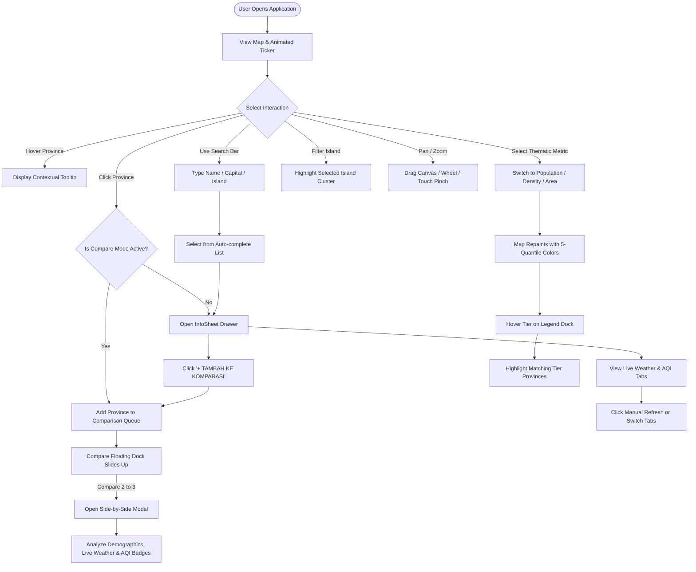

# Product Requirements Document (PRD)

## Indonesia Interactive Map (Digital Geospatial System for 38 Indonesian Provinces)

---

### Document Metadata

- **Project Name:** Indonesia Interactive Map
- **Document Version:** 1.1.0
- **Status:** Approved / Active Production Specification
- **Last Updated:** October 17, 2026
- **Target Platform:** Web (Desktop, Tablet, Mobile)
- **Core Technology Stack:** React 18, TypeScript, Vite, Tailwind CSS, Framer Motion, Radix UI, Open-Meteo APIs (Weather & Air Quality)

---

## 1. Executive Summary

**Indonesia Interactive Map** is a modern, interactive geospatial web application that showcases the archipelago of the Republic of Indonesia across all **38 official provinces**, fully incorporating the 4 New Autonomous Regions (DOB / _Daerah Otonom Baru_) in Papua (South Papua, Central Papua, Highland Papua, and Southwest Papua) in accordance with the latest government regulations.

The application pairs a bold, high-contrast **Neobrutalism** visual identity with analytical Geographic Information System (GIS) and atmospheric monitoring capabilities: thematic mapping (_Choropleth_ maps powered by official BPS statistical quantile distributions), island archipelago filters, instant keyboard-navigable search with auto-complete, fluid canvas navigation (_pan & pinch-to-zoom_), a side-by-side multi-province comparison matrix, adaptive dark mode support, and **real-time live weather and air quality index (AQI) integration** for all 38 provincial capitals via the Open-Meteo open-source environmental APIs.

---

## 2. Background & Problem Statement

### 2.1 Geopolitical Context & Territorial Expansion

Prior to 2022, Indonesia comprised 34 provinces. Following the ratification of parliamentary laws establishing four new provinces in Papua and the issuance of Ministry of Home Affairs Decree (_Kepmen Mendagri_) No. 100.1.1-6117 of 2022, the official number of provinces increased to 38. Most online cartographic resources still depict outdated 34-province boundaries.

### 2.2 Problems Solved

1. **Outdated Digital Cartography:** Scarcity of modern, lightweight, interactive vector SVG maps representing all 38 provinces for students, educators, and developers.
2. **Static Demographic Data:** Official statistics from Statistics Indonesia (_Badan Pusat Statistik / BPS_) are predominantly distributed in static tables or PDFs, making spatial comprehension difficult.
3. **Absence of Direct Spatial Comparison:** Lack of tools enabling side-by-side comparison of sub-national indicators (population, land area, population density).
4. **Disconnected Atmospheric & Environmental Context:** Provincial exploration historically lacked live climate context (temperature, conditions, wind, air pollution) crucial for disaster preparedness, public health, and ecological awareness.

---

## 3. Product Vision & Target Audience

### 3.1 Vision Statement

> _"To deliver the most precise, aesthetic, performant, and frictionless digital geospatial and atmospheric portal for Indonesia, accessible from any device without requiring installation."_

### 3.2 Target Audience & User Personas

| Persona                         | Profile & Needs                                                                                                                              | Usage Pattern                                                                                                                                     |
| ------------------------------- | -------------------------------------------------------------------------------------------------------------------------------------------- | ------------------------------------------------------------------------------------------------------------------------------------------------- |
| **Educators & Students**        | Geography teachers, university lecturers, secondary school and college students needing up-to-date geography materials.                      | Exploring province locations, provincial capitals, official time zones (WIB/WITA/WIT), live regional weather, and island clusters.                |
| **Researchers & Data Analysts** | Public policy analysts, data journalists, and environmental/socio-economic researchers.                                                      | Analyzing population disparities, regional air quality indices (AQI), and demographic densities across Java vs. outer islands.                    |
| **Web Developers & Designers**  | Frontend engineers and UI/UX designers seeking high-performance SVG vector map and live API implementations.                                 | Inspecting pan-zoom math, SVG path coordinate extraction pipelines, Open-Meteo caching, and Neobrutalist design systems.                          |
| **General Public & Travelers**  | Citizens, travelers, and enthusiasts wanting an intuitive, engaging tool to learn about Indonesia's geographic and meteorological diversity. | Looking up hometown data, checking live weather in destination capitals, checking air quality before outdoor activities, and comparing provinces. |

---

## 4. Functional Requirements

```
┌────────────────────────────────────────────────────────────────────────┐
│                        CORE APPLICATION FEATURES                       │
├─────────────────┬──────────────────┬─────────────────┬─────────────────┤
│ Interactive SVG │ Thematic Engine  │ Live Atmosphere │ Multi-Province  │
│ Vector Canvas   │ (Choropleth)     │ (Weather & AQI) │ Comparison      │
│                 │                  │                 │                 │
│ • 38 Provinces  │ • Population     │ • Real-time Wx  │ • Up to 3 provs │
│ • Pan & Zoom    │ • Density        │ • US AQI & Tiers│ • Floating Dock │
│ • Tooltip Hover │ • Land Area      │ • PM2.5, PM10, O3│ • Side-by-side │
│ • Touch & Pinch │ • 5 Quantiles    │ • 10-Min Cache  │ • Visual Bars   │
└─────────────────┴──────────────────┴─────────────────┴─────────────────┘
```

### FR-01: Interactive Vector SVG Canvas

- **Specification:** Renders crisp vector graphics (SVG) representing all 38 Indonesian provinces inside a responsive `viewBox="0 0 800 350"`.
- **Interactions:**
  - _Hover State:_ Highlights the targeted province with a distinctive fill color and border stroke, triggering the contextual floating tooltip.
  - _Click State:_ Opens the province detail drawer (_InfoSheet_), or toggles selection if Comparison Mode is active.
  - _Focus State:_ Supports keyboard tab navigation (`Tab`, `Enter`, `Space`) with visible high-contrast focus rings.

### FR-02: Smooth Pan & Zoom Engine

- **Scale Range:** Minimum scale $0.75\times$ (75%), default scale $1.0\times$ (100%), up to a maximum of $6.0\times$ (600%).
- **Navigation Modalities:**
  1. _Mouse Drag:_ Fluid canvas panning with elastic resistance boundary damping when approaching viewport limits.
  2. _Mouse Wheel:_ Responsive cursor-centered zoom in and zoom out.
  3. _Touch Gestures:_ Single-finger canvas pan and two-finger pinch-to-zoom on touch devices.
  4. _Keyboard Shortcuts:_ `+` / `=` to zoom in, `-` to zoom out, `0` / `r` to reset canvas view to 100%.
  5. _Zoom Controls Dock:_ Floating bottom-right control panel displaying exact zoom percentage with manual zoom in, zoom out, and reset buttons.

### FR-03: Quick Search & Island Filters

- **Location:** Anchored as a floating sticky header at the top of the viewport.
- **Search Capabilities:**
  - Instant query filtering matching province names, provincial capitals, or island cluster names.
  - Full keyboard accessibility within search results (`ArrowDown`, `ArrowUp`, `Enter`, `Escape`).
- **Island Cluster Filters:**
  - Filter segments: _All_, _Sumatera_, _Jawa_, _Kalimantan_, _Sulawesi_, _Bali & Nusa Tenggara_, _Maluku_, and _Papua_.
  - Live count badges indicating active provinces per island cluster.
  - Non-matching provinces are visually dimmed (opacity 0.25) to focus user attention on the selected cluster.

### FR-04: Thematic Choropleth Engine

- **Supported Metrics:**
  1. **Population (Jiwa):** Based on official BPS 2023 interim projections. Sequential _Indigo / Blue_ color palette.
  2. **Population Density (Jiwa/km²):** Computed ratio of $\frac{\text{Population}}{\text{Land Area}}$. Sequential _Warm Amber / Orange / Deep Red_ color palette.
  3. **Land Area (km²):** Official land area based on Kepmen Mendagri No. 100.1.1-6117 of 2022. Sequential _Emerald / Teal_ color palette.
- **Classification Method:** 5-tier quantile distribution (20%, 40%, 60%, 80%, 100%) ensuring balanced visual representation across extreme regional variations.
- **National Aggregates:** Computes national totals, minimum benchmark province, and maximum benchmark province automatically.

### FR-05: Interactive Thematic Legend

- **Presentation:** Floating dock positioned in the bottom-left corner.
- **Interactive Quantile Filtering:**
  - Hovering over a specific quantile tier highlights matching provinces on the map while dimming provinces belonging to other tiers.
  - Collapsible on mobile viewports ($< 640\text{ px}$) to preserve map visibility.

### FR-06: Contextual Data Tooltip

- Tracks cursor movement dynamically while enforcing viewport boundary collision clamping.
- Displays province name, island cluster, formatted active metric value, national rank (e.g., `#1/38`), and percentage contribution to the national total (% NAT).
- Displays active comparison selection indicators and quick-navigation hints using standardized Lucide SVG icons.

### FR-07: Province Detail Sheet Drawer (InfoSheet)

- Slide-over drawer appearing from the right side of the screen upon selecting a province.
- Displays:
  - Island cluster badge and official province name.
  - Capital city and official time zone (WIB / WITA / WIT).
  - Demographic statistics: Population, land area, and population density formatted in Indonesian locale (`id-ID`).
  - **Embedded Live Weather & Air Quality Card (`WeatherCard`):** Dual-tab interactive widget presenting live temperature, apparent temperature, humidity, wind speed, WMO weather icon, US AQI score, health category badge, pollutant concentrations (PM2.5, PM10, Ozone), observation timestamp, and official time zone.
  - Historical and geographic summary profile.
  - "+ TAMBAH KE KOMPARASI" toggle action button with instant visual feedback.
  - Citation notes and direct outbound link to the corresponding Indonesian Wikipedia article.

### FR-08: Side-by-Side Multi-Province Comparison Matrix

- **Capacity:** Compares up to 3 provinces simultaneously.
- **Components:**
  1. _Compare Floating Dock:_ Bottom action dock that slides in when 1 or more provinces are selected, showing colored identifier pills (Blue, Amber, Emerald), quick-remove buttons, and comparison button.
  2. _Compare Modal Dialog:_ Full-width comparison modal featuring a side-by-side data table with:
     - Proportional progress bars for Population, Land Area, and Density.
     - **Live Weather Badge (`CompareWeatherBadge`):** Shows real-time temperature and WMO weather condition for each compared provincial capital.
     - **Live Air Quality Badge (`CompareAirQualityBadge`):** Shows real-time US AQI score and color-coded health level badge for each compared provincial capital.
     - Quick province replacement dropdown organized by island clusters.

### FR-09: Neobrutalism Design System & Standardized Iconography

- Distinctive Neobrutalist design: heavy black borders (`border-2 border-black`), sharp non-blurred offset shadows (`shadow-brutal`), bold color accents, and dual typography (_Space Grotesk_ for display, _JetBrains Mono_ for data).
- **Standardized Lucide SVG Iconography:** Replaced all unicode text glyphs (e.g., ★, •, ✓, +, →) with crisp, accessible vector SVG icons (`Star`, `Check`, `Plus`, `ArrowRight`, `MapPin`, `Users`, `Maximize2`, `Clock`, `CloudSun`, `Wind`, `Activity`).
- Instant Dark / Light mode switching with `localStorage` persistence and automatic `prefers-color-scheme` detection.
- Continuous animated marquee ticker ribbon at the screen bottom reinforcing national identity.

### FR-10: Spatial Vector Extraction Pipeline

- Standalone CLI utility (`utils/extractPathData.js`) that parses raw SVG maps and updates `src/data/indonesia-map.json` coordinates without overwriting existing demographic and administrative metadata.

### FR-11: Real-time Meteorological Forecasting Engine

- **Provider:** Open-Meteo Weather API (`https://api.open-meteo.com/v1/forecast`).
- **Geocoding:** Exact coordinates (latitude and longitude) mapped for all 38 provincial capitals (`PROVINCE_COORDINATES` in `src/utils/weather.ts`).
- **Parameters Fetched:** Current temperature (°C), apparent/feels-like temperature (°C), relative humidity (%), wind speed (km/h), and WMO weather code.
- **WMO Code Mapping:** Translates standard WMO codes (0 to 99) into localized descriptions (_Cerah_, _Cerah Berawan_, _Hujan Ringan_, _Hujan Badai Petir_, etc.) paired with corresponding Lucide weather icons.
- **Caching & Resilience:** 10-minute client-side in-memory cache (`CACHE_TTL_MS = 600,000`) and 8-second request timeout via `AbortController`.

### FR-12: Real-time Air Quality Index (AQI) & Health Assessment

- **Provider:** Open-Meteo Air Quality API (`https://air-quality-api.open-meteo.com/v1/air-quality`).
- **Parameters Fetched:** US Air Quality Index (US AQI), particulate matter $\text{PM}_{2.5}$ ($\mu\text{g/m}^3$), $\text{PM}_{10}$ ($\mu\text{g/m}^3$), and Ground-level Ozone $\text{O}_3$ ($\mu\text{g/m}^3$).
- **Health Category Evaluation:**
  - $0 - 50$: _Baik / Good_ (Emerald) — Safe for all outdoor activities.
  - $51 - 100$: _Sedang / Moderate_ (Amber) — Acceptable; sensitive individuals advised caution.
  - $101 - 150$: _Kurang Sehat / Unhealthy for Sensitive Groups_ (Orange) — Vulnerable groups should limit exertion.
  - $151 - 200$: _Tidak Sehat / Unhealthy_ (Red) — Health effects possible; masks recommended.
  - $201 - 300$: _Sangat Tidak Sehat / Very Unhealthy_ (Purple) — Serious health warnings; avoid outdoor activities.
  - $> 300$: _Berbahaya / Hazardous_ (Deep Rose) — Emergency health conditions; stay indoors.
- **Caching:** 10-minute in-memory cache to prevent redundant API calls.

---

## 5. Non-Functional Requirements

### 5.1 Performance & External API Resilience

- **First Contentful Paint (FCP):** $\le 1.0$ second on standard broadband connections.
- **Frame Rate:** Sustained 60 FPS animation during pan, zoom, and SVG path hover transitions.
- **API Reliability:** Open-Meteo calls require zero API keys and run on public open-source infrastructure. Network calls are guarded by an 8-second `AbortController` timeout and fall back gracefully with clear UI notices if offline.
- **Client Caching:** 10-minute in-memory TTL caching prevents API rate limits and ensures rapid tab/modal re-inspections.
- **Bundle Efficiency:** Modular Rollup vendor chunking (`vendor-react`, `vendor-motion`, `vendor-radix`, `vendor-icons`) ensuring optimal browser cache utilization.

### 5.2 Accessibility (A11y)

- All SVG paths include `aria-label`, `role="button"`, and `tabIndex={0}`.
- Comprehensive keyboard navigation (`Tab`, `Enter`, `Space`, `Arrow Keys`, `Escape`, `+`, `-`, `0`, `r`).
- Color contrast ratios comfortably exceed WCAG 2.1 Level AA requirements via high-contrast Neobrutalist borders and text fills.
- Text glyphs replaced with semantic Lucide SVG icons with proper alignment and contrast.

### 5.3 Browser & Device Support

- **Supported Browsers:** Google Chrome, Mozilla Firefox, Apple Safari, Microsoft Edge (latest 2 versions).
- **Responsive Layout:** Adaptive from compact smartphones (minimum width 320px) up to ultra-wide 4K monitors.

---

## 6. Information Architecture & User Flows



---

## 7. Success Metrics & Key Performance Indicators (KPIs)

1. **Information Discovery Efficiency:** Users locate target demographic or meteorological metrics for any given province in $< 5$ seconds.
2. **Feature Engagement:** At least $40\%$ of active user sessions interact with thematic choropleth layers, live weather/AQI cards, or multi-province comparison matrices.
3. **Runtime Stability:** 0 unhandled console runtime exceptions in production, maintaining a Google Lighthouse Performance score $\ge 90$ and Accessibility score $\ge 95$.
4. **API Availability:** Real-time weather and AQI queries resolve successfully in $> 98\%$ of requests, with cache hit ratios exceeding $60\%$ during active sessions.

---

## 8. Product Roadmap

| Phase    | Status / Target | Delivered / Planned Initiatives                                                                                                                                                                                                                                                                                                                  |
| -------- | --------------- | ------------------------------------------------------------------------------------------------------------------------------------------------------------------------------------------------------------------------------------------------------------------------------------------------------------------------------------------------ |
| **v1.0** | **Delivered**   | • 38 Official Provinces with 4 Papua DOBs.<br>• Neobrutalism theme & dark mode.<br>• Pan & zoom engine with boundary clamping.<br>• 5-Quantile thematic choropleth (Population, Density, Area).<br>• Multi-province comparison matrix (up to 3 provinces).                                                                                       |
| **v1.1** | **Delivered**   | • **Open-Meteo Live Weather API integration** (temperature, humidity, wind, WMO codes).<br>• **Open-Meteo Live Air Quality Index (AQI) integration** (US AQI, PM2.5, PM10, Ozone).<br>• Dual-tab `WeatherCard` in province detail drawer.<br>• Live weather & AQI badges in comparison modal.<br>• Standardized Lucide SVG iconography refactor. |
| **v1.2** | Q1 2027         | • Visual Map Snapshot Export (PNG, SVG, PDF) at high print resolution.<br>• Deep-linking URL parameters for direct state sharing (e.g., `?prov=IDBA&metric=density`).<br>• Additional socio-economic indicators from BPS: Human Development Index (HDI / IPM), Regional Gross Domestic Product (GRDP / PDRB), and Poverty Headcount Ratio.       |
| **v2.0** | Q4 2027         | • Hierarchical geospatial drill-down to Regency / City (_Kabupaten / Kota_) level across all 38 provinces.<br>• Comparison table data export to Excel (XLSX) and CSV formats.                                                                                                                                                                    |
